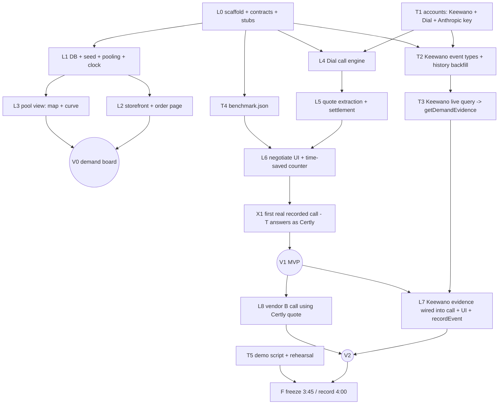

# Work-in-progress dependency graph

**Protocol**
- `git pull --rebase` before starting any task; update your own task row's Status, then commit + push **WIP/ changes straight to `main`** (`wip: <task> <status>`). Code goes through your branch.
- Only the task owner edits a row. Blockers / contract changes / keys-ready go in `WIP/LOG.md` (append-only, timestamped).
- Status: `todo` · `doing` · `blocked(<why>)` · `done` · `cut`.
- Owners: **L** = Lead (Cindy's Claude Code session) · **T** = Teammate (own Claude Code session + human).

| ID | Owner | Ver | Target | Status | Depends on | Files | Done when |
|---|---|---|---|---|---|---|---|
| T1 | T | — | 2:15 | todo | — | none (keys → `.env.local`, shared out-of-band) | Keewano project with `#SpeedHacks` unlocked, event API key + `kwpat-` PAT; Dial account + verified number + API key; Anthropic API key. Posted "keys ready" in LOG. |
| L0 | L | V0 | 2:10 | done | — | repo scaffold, `lib/contracts.ts`, `lib/keewano/index.ts` stub, `data/benchmark.json` stub, `.env.example` | `pnpm dev` runs; contracts committed; T can branch. |
| T2 | T | V2 | 2:45 | todo | T1, L0 | `lib/keewano/**`, `scripts/keewano/**` | Custom event types registered; synthetic 90-day history ingested (labeled synthetic). **Must land by 2:45** (≈5 min query latency). |
| T3 | T | V2 | 3:10 | todo | T2 | `lib/keewano/**` | `getDemandEvidence('soc2_compliance')` returns live Keewano numbers + query text; falls back to `keewano_cached` (with age) / `unavailable`. |
| T4 | T | V1 | 2:40 | todo | L0 | `data/benchmark.json` | Steps filled; ≥1 `observed` baseline (timed real "contact sales" form, not submitted); rest tagged `estimate` with note. |
| T5 | T | — | 3:40 | todo | — | `demo/**` | `demo/SCRIPT.md` timed to ≤4:45; rehearsal done once. |
| L1 | L | V0 | 2:30 | doing | L0 | `lib/db.ts`, `lib/clock.ts`, `lib/pool/**`, `lib/seed.ts` | 14 simulated buyers seeded; pool + exclusions computed; clock offset works. |
| L2 | L | V0 | 2:40 | doing | L1 | `app/page.tsx`, `app/orders/**`, `app/api/orders/**` | Order → "confirmed" with hold; cancel works; idempotent. |
| L3 | L | V0 | 2:45 | doing | L1 | `app/pool/**`, `app/api/pool/route.ts`, `components/**` | Map + curve + exclusions render from real DB state. |
| L4 | L | V1 | 2:55 | doing | L0, T1 | `lib/dial/**`, `app/api/pool/negotiate/**`, `app/api/calls/**` | Real outbound call placed and transcript polled. |
| L5 | L | V1 | 3:05 | doing | L4 | `lib/quote/**`, `lib/settle/**`, `app/api/pool/settle/**` | Transcript → Quote (Claude); settle applies SPEC §4 rules. |
| L6 | L | V1 | 3:10 | doing | L5, T4 | `app/pool/**`, `components/**` | Call panel + transcript + quote cards + time-saved counter. |
| X1 | L | V1 | 3:15 | todo | L6, T1 | — | One real Dial call A→B with AI Certly persona; stored for replay (`source: recorded_replay`). Human fallback if AI vendor fails. |
| L7 | L | V2 | 3:30 | todo | T3, V1 | `lib/dial/prompt.ts`, `app/pool/**`, order routes | Evidence numbers appear in call instruction + evidence card; events recorded on order/cancel. |
| L8 | L | V2 | 3:40 | todo | V1 | `lib/dial/prompt.ts` | Vantly call cites Certly's extracted quote; Cindy answers. **Cut first if late.** |
| F | L+T | — | 3:45 | todo | V2/V1, T5 | — | Acceptance tests (SPEC §9) pass; recording starts 4:00. |
